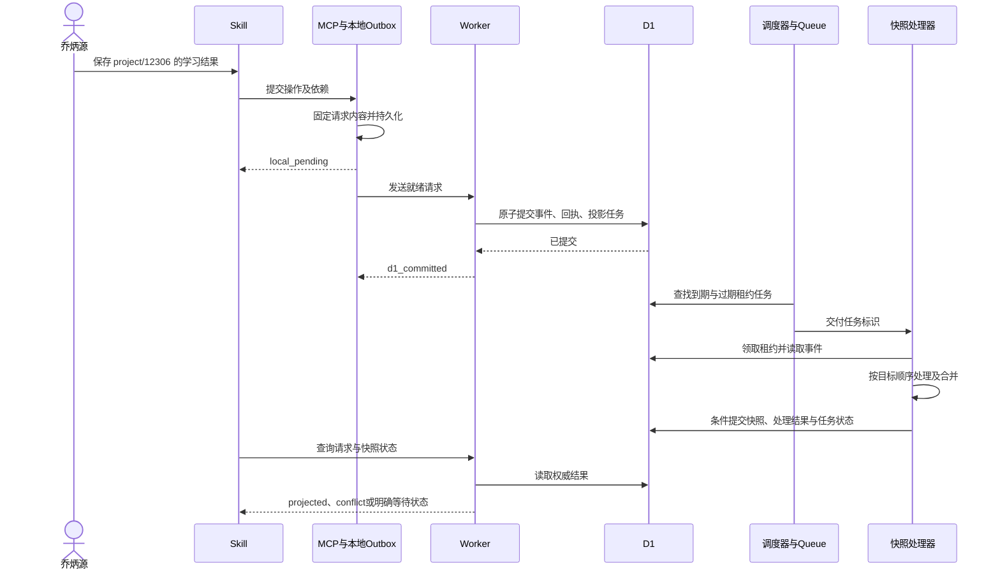
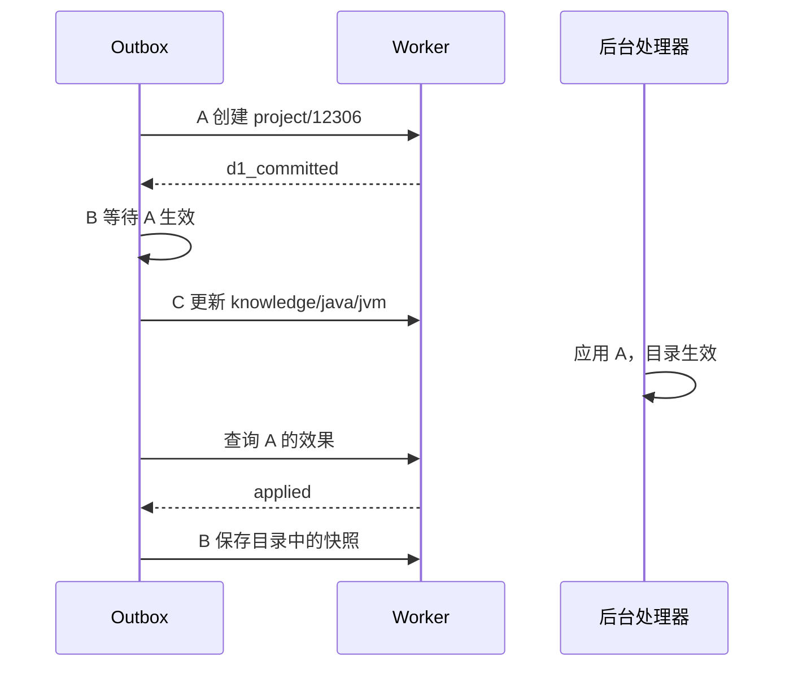

# RDS-JBryon 单用户目录与异步快照设计

日期：2026-10-26（Asia/Shanghai）  
状态：已完成独立设计审查，等待用户审阅；未实现、未部署、未清理数据。  
产品名称：RDS-JBryon。唯一使用者及管理员：乔炳源。

## 1. 目标与已确认决定

将 RDS-V2 改造成面向个人学习的目录与快照持久化服务。用户用项目或知识主题找到历史学习记录，无需提供 UUID、选择账户或确认账户身份。减少多用户及 Drive 归档模块，同时保留可靠交付、异步任务和故障恢复能力。

以下来自本次对话中的用户决定：

1. 只服务乔炳源，删除注册、用户选择、姓名解析、账户与业务身份绑定流程。
2. 产品正式命名 RDS-JBryon。
3. 旧 RDS 业务数据全部清空，按全新工作区启动，不迁移旧历史。
4. 不使用 Drive；保留 Outbox、云端队列、租约、重试、定时恢复。
5. 采用方案 B：D1 接收事件，后台异步生成快照；不采用同步保存最终快照的方案 A。
6. 目录可多层嵌套，例如 project/12306、project/rpc、knowledge/java/jvm、knowledge/java/juc；目录名由用户决定。
7. 新建顶层 domain 前确认名称和位置；用户直接明确指定创建名称时即构成该次授权，不重复问一次同样的问题。
8. 用户有完整的目录、文件创建、修改、重命名、移动和删除权限。
9. 独立新增自动合并；同一字段存在不同修改时保留双方，交由用户确认，可由模型协助提出合并结果。
10. 删除目录时，删除其后代内容及相关未同步 Outbox 数据，不保留正文供用户重新选择去向。
11. 结果未确定或未生效的操作阻塞其依赖请求，无关项目照常同步。
12. 学习与模拟面试后续共享持久化快照；首答和后续答题分别表达，昨日框架回顾不作为答题写入。这属于 Skill 的业务契约，RDS 不负责判断知识掌握情况。

本设计采用以下工程建议，尚需随本文一并审阅：单服务连接密钥、通用 JSON 文件、稳定内部节点标识、按文件组织投影、明确的删除门禁、确定性的字段合并、下述预算及协议命名。它们不应描述为用户逐项明确指定的实现。

## 2. 方案比较与选择

| 方案 | 组成 | 取舍与选择 |
| --- | --- | --- |
| A：同步快照 | Outbox → Worker → D1 同步更新快照与回执 | 后台模块少；用户未选 |
| **B：异步快照** | Outbox → Worker → D1 事件/任务 → Queue → 快照 | 保留可靠后台处理及恢复；**用户已选** |
| Drive JSON 存储 | Drive 文件夹、文件及相应调用链 | 用户已明确不使用 Drive |

轻量化边界：去除用户体系、租户隔离逻辑、Drive OAuth/归档/归档队列、固定业务域白名单和与通用快照无关的业务 reducer；复用并改造 Outbox、幂等、任务租约、预算、恢复和投影机制。保留事件与任务不是宣称云端永不故障；故障时允许等待，但不得丢失已确认落盘的请求或伪报完成。

## 3. 当前源码依据与变更范围

以下仅说明已读取的本地实现，不代表线上状态或本设计已经实现：

- `tools/reliable-drive-sync-mcp/delivery-service-v2.mjs`：单实例 flush 防重入，循环逐条 await 发送；发送失败后当前实现仍会尝试后续请求。
- `tools/reliable-drive-sync-mcp/local-outbox-v2.mjs`：SQLite 持久化、领取租约、恢复过期领取及回执确认。
- `services/reliable-drive-sync-worker/src/rds2/events/accept.js`：现有事件、回执、投影任务及归档任务在 D1 batch 内接受，存在账户交叉校验。
- `services/reliable-drive-sync-worker/src/rds2/tasks/{repository,dispatcher,recovery}.js`：任务领取、租约 epoch、防止过期提交、失败退避及定时恢复。
- `services/reliable-drive-sync-worker/src/rds2/projection/{engine,commit,builds}.js`：前序事件检查、版本条件提交及后台构建。
- `services/reliable-drive-sync-worker/src/rds2/query.js`：现有游标和查询与账户相关，普通 profile 读取尚无通用目录过滤。
- `services/reliable-drive-sync-worker/migrations/0006_rds2_v2_tables.sql`：现有事件、请求、任务及投影按 user_id 组织。

目标仓库为 `C:/Users/27846/my-chatgpt-mcp-v2`。原仓库已经存在未提交改动，实施时必须先记录当前差异，保护用户改动。本设计文件只新增到 docs；不顺带修改 S 仓库、安装副本或线上资源。后续独立执行计划应列明哪些已验证模块可复用、哪些必须替换；不得以“删除 user_id 字段”代替跨表协议改造。

## 4. 系统组成与状态承诺



| 层级 | 权威状态 | 可以告诉用户什么 |
| --- | --- | --- |
| 本地交付 | local_pending / sending / cloud_acknowledged / waiting_dependency / delivery_blocked / cancelled | 已落盘、待发送、云端已接收、依赖等待或需处理 |
| 云端接受 | d1_committed | 事件及处理责任已在 D1 持久化，不能声称快照已更新 |
| 云端效果 | pending / applied / applied_noop / conflict / cancelled / needs_attention | 分别表示未应用、已应用、无需变化、待合并、已取消和技术故障 |
| 用户显示 | projected | 仅对 applied/applied_noop 的权威结果显示“本次修改已生效” |

取消 Drive 后没有 archive 状态。Outbox 收到 D1 回执可停止传输重试，但依赖调度仍需查询云端效果；cloud_acknowledged 不等于依赖已经满足。

## 5. 单用户与连接边界

- 不建用户、角色、凭据到用户映射及注册表；协议不接收 username/userId 作为业务输入，不调用 user.resolve。
- 部署配置中固定显示名称“乔炳源”，仅用于产品显示，不作为授权凭证。
- 建议保留一个自动使用的服务连接密钥，成功连接即拥有该个人服务的全部管理能力。无用户登录、账户选择或身份确认界面。
- Drive 凭据与归档模块退出新链路。Cloudflare 部署凭据属于基础设施配置，不是业务用户体系。
- 旧 user_id 不转换成目录字段。服务拥有随机 workspaceEpoch，在全量重置时更换，用于阻止旧客户端重放旧工作区数据；它不是用户标识。

## 6. 目录与文件模型

### 6.1 概念与路由

domain 是根目录下的一级业务文件夹，不等于旧 namespace/projectionName。domain、普通目录和快照文件构成同一棵树，目录树是 D1 记录的查询结果，不反复读写一份无限增长的大 JSON。

```text
project/
  12306/
    项目概览.json
    余票展示/
      学习快照.json
  rpc/
    学习快照.json
knowledge/
  java/
    jvm/
      学习快照.json
    juc/
      学习快照.json
```

用户可自定义或重命名这些节点。文件名不是固定业务开关；目录可以记录 defaultSnapshotId，默认快照改名/移动仍按内部关联读取。没有默认文件且候选不唯一时先展示候选，不按最近时间猜测。

外部路径使用数组，例如 `["knowledge","java","jvm","学习快照.json"]`；显示时格式化为斜杠路径。目录名采用 NFC 规范化，可用中文；拒绝空名、斜杠、反斜杠、`.`、`..`，同一父目录的规范化名称唯一。路径只是定位入口；首次入队后固定目标 nodeId，重试不重新按同名路径选择目标。

每个节点有系统生成的稳定 nodeId。用户无需知道或输入它。重命名、移动保留 nodeId；删除后同名重建产生新 nodeId，旧请求不能落到新目录。

### 6.2 目录接口展示 JSON（设计示例，不是真实数据）

```json
{
  "catalogRevision": 8,
  "routes": {
    "project": {
      "12306": {"title": "12306 购票系统", "children": ["项目概览.json", "余票展示"]},
      "rpc": {"title": "Pig RPC", "children": ["学习快照.json"]}
    },
    "knowledge": {"java": {"jvm": {}, "juc": {}}}
  }
}
```

实际 API 的目录条目必须返回 kind、nodeId、name、parentId、lifecycle、revision；上面仅是面向用户的树形展示。目录深时分页展开 children，不强制返回整棵树。自然语言名称可结合目录元信息查找候选，只有唯一确定或经用户选择的候选才能成为写入目标。

### 6.3 查询与管理员操作

- 只读：capabilities、directory.list、directory.resolve、snapshot.read、snapshot.query、snapshot.history、request.status、conflict.list、task.status、deletion.manifest。
- 写入：directory.create/rename/move/delete，snapshot.create/patch/delete，conflict.resolve，task.retry。
- snapshot.read 精确读取文件；snapshot.query 按目录前缀/节点子树查询，默认返回元信息，内容按需读取。目录路径先定位节点，再使用索引读该节点或后代，不能每次扫描全部学习正文。
- directory.move 拒绝把节点移到自己或自己的后代；目标父目录必须生效且未删除。目录结构变更增加 catalogRevision；文件内容更新增加自身 revision。
- 新建 domain 的人类确认由 Skill/交互层获取并保存可定位的确认引用。`confirmed: true` 本身不能被宣传成服务端验证过真人授权；拥有连接密钥的用户调用本身具有管理员权限。
- v1 文件内容是 JSON；笔记文本可作为 JSON 字段保存。二进制附件、音频存储和可视化文件管理界面不属于本次范围。

## 7. 业务数据及协议边界

建议新的 MCP 服务标识为 `rds-jbryon`，唯一工具名为 `rds`，按 operation 分发读写；显示名称 RDS-JBryon。新 API 使用 `protocol: "rds-jbryon", apiVersion: 1`，旧 storageVersion=2 协议不在新入口自动转换。物理仓库路径暂保留，包名、插件元信息、部署资源及客户端配置在后续执行计划中显式映射。

写请求的核心字段：workspaceEpoch、requestId、operation、target（稳定节点标识及必要父节点）、dependsOn、baseRevision（内容修改时）、changes、可选交互证据引用。requestId、操作及业务载荷入队后冻结；发送次数和本地时间不改变请求内容。查询不进入 Outbox。

建议 D1 数据对象如下；最终 SQL 和模块分拆属于实现计划，但语义不可缺失：

| 对象 | 职责与关键约束 |
| --- | --- |
| workspace_meta | 当前工作区 epoch、catalogRevision、产品协议版本；无用户表 |
| nodes | parentId/name/kind/lifecycle、稳定标识、目录元信息；有效同级名称唯一 |
| requests | requestId 唯一、规范化内容哈希、接受回执、效果状态、目标引用；区分成功、冲突、取消 |
| events | 稳定事件标识、目标节点、顺序、操作、基准版本、依赖；D1 是权威输入 |
| tasks | 待调度/已排队/处理中/已完成/需处理、租约 owner/epoch/expiry、重试时间 |
| snapshots | 文件当前 JSON 与 revision；只有成功应用改变内容版本 |
| snapshot_versions | 用于基准校验、三方合并及修订查看；删除文件时正文同样清除 |
| conflicts | 基准、当前、提议的可定位版本/差异、解决状态；删除目标时清除正文 |

删除标记可存 nodes 中，不强制新增一张表。父子索引支持逐级定位；递归查询与目录变更采用有界祖先/后代遍历。目录上限和大型删除分批处理见第 12 节。

RDS 是通用 JSON 可靠存储，不推断面试评分、简历贡献或掌握度。项目学习与模拟面试通过同一路由/节点读取共享快照，以独立 attemptId 追加答题；相关字段约束在 Skill 接口契约中验证。用户明确管理修改可产生新内容版本，业务 Skill 不得静默把首答改成改进答案。

## 8. 接受、幂等与数据库原子性

1. 写请求先由本地 SQLite 提交，再发送；本地提交失败不能显示已保存。
2. 服务端按 requestId 查询：同 ID 同哈希返回原回执及当前效果；同 ID 不同哈希拒绝 request_id_conflict。
3. 新请求在一个 D1 原子 batch 中写入事件、接受回执、后台任务及必要门禁。接受成功必须有真实 D1 提交结果。Queue.send 不属于此事务，失败由 D1 中的任务恢复。
4. 并发唯一约束冲突后读取权威记录重新分类，不把所有异常一律当作重复成功。不同请求 ID 不因内容相似而自动去重；独立新增记录使用稳定 itemId 做业务级重复检查。
5. 投影提交必须同时保护 task owner、leaseEpoch、leaseUntil、目标有效状态、读取的快照 revision 及目录结构版本。不得先更新快照，再单独检查租约。
6. D1 batch 中条件 UPDATE 影响 0 行不会自动等同于 SQL 异常。本设计选定沿用现有 commit_guards + 数据库触发器的 guarded-batch 构造：batch 第一条插入提交守卫，触发器原子验证租约 owner/epoch/expiry、目标及祖先有效状态、目录结构版本、基准快照版本和处理顺序；任一不符以数据库错误中止整批。守卫通过后再写快照/版本/冲突或取消结果、请求效果和任务完成，最后移除守卫。结构删除等特殊任务使用对应允许 deleting 的专用守卫，不能复用普通写入谓词。必须用并发与故障注入证明；禁止在 batch 提交后才根据 0 行发现已写入了成功回执。旧守卫含 user_id 和归档相关约束，新 schema 必须明确重建，不能原样照搬。
7. 不要求全链路 exactly-once 传输。消息允许重复，接受及业务效果必须幂等。

## 9. 并发合并与异步顺序

### 9.1 内容合并

每个文件有独立 revision。请求声明 baseRevision，服务端读取该基准的真实历史版本、当前版本与请求 changes，执行确定性的三方比较。不能仅相信模型传入的 oldValue。

- 本设计 v1 使用明确的字段 set/remove 及按 itemId 的追加操作。数组按下标的并发合并不支持；对集合使用 `{itemId: item}`，同 ID 同内容为 no-op、同 ID 不同内容为冲突。
- 新增不同 itemId、修改互不重叠的字段可自动合并；JSON 父路径与子路径视为重叠。
- 相同字段已被改成同一值，可应用为 applied_noop，不额外增加快照内容版本。
- 同一字段出现不同修改或删除与修改重叠，保存双方并标为 conflict。一个请求包含多个操作时整体应用或整体冲突，不偷偷应用其中一部分。
- conflict.resolve 是新请求，引用原冲突及解决时的版本；若期间又有重叠修改，再次形成明确冲突。模型提出方案，用户确认冲突字段选择，不能自动取最后写入者。
- 原冲突请求保持 effect=conflict，并关联 resolvedByRequestId；解决成功不把原请求伪装成“原提议已经执行”。依赖原冲突请求的旧请求进入 dependency_replan_required，不自动放行、不耗尽故障重试。用户/模型根据已选结果重新核对其意图，建立带新 requestId、当前基准版本及新依赖的替代请求；不修改旧冻结请求。替代关系明确后旧请求标记 superseded，未替代前保留其内容供重新规划，目录删除例外按删除规则清除。即使选择了原提议，也统一重新核对旧依赖，避免部分后续操作基于已过时条件执行。

### 9.2 顺序与作用域

- 本地每个发送实例并发数先保持 1；多个进程/设备仍可能并发，云端规则不可删除。
- 调度器只领取“依赖就绪且当前可发送”的请求；一次只为将要发送的请求领取本地租约，避免整批提前占有租约、队尾发送前已过期。
- 依赖就绪要求云端效果 applied/applied_noop，而不只是 d1_committed；失败、结果未知和未投影都继续等待。依赖进入 conflict/needs_attention 时后续保持阻塞并说明原因；冲突解决后的旧依赖按第 9.1 节进入重新规划而非永久等待。依赖取消/目标删除时后续取消。
- 同一文件按其服务端接受顺序处理；元信息变更按目录结构版本处理。不同目标节点可独立推进，不能用全局“前一条未完成”阻塞整个工作区。
- 区分 lastProcessedEventSeq 和“某请求是否已应用”。冲突或取消可标为已处理并推进本文件处理位置，后续无依赖的事件可继续；依赖该冲突请求的操作仍不就绪。不能把已处理游标推进等同于冲突内容已应用。
- 依赖不存在、跨 workspaceEpoch、成环都明确拒绝或阻塞，不能盲等；依赖链采用有界检查，不能修改已冻结事件来“修复”循环。



## 10. 队列、租约与故障恢复

- D1 保存权威任务内容，Queue 只携带 taskId/type/attempt；不携带学习正文。
- 调度时领取租约，入队后条件回写；处理器先领取处理租约。晚到的调度回写不能把 processing/completed 改回 queued。
- 每次接管提高 leaseEpoch，提交检查 owner、epoch、未过期和目标状态。过期工作者的全部业务写入必须失效，不仅仅是“完成任务”那一步失效。
- 默认沿用当前机制的 5 分钟云端租约与每分钟恢复扫描，作为可配置工程初值；处理时间必须有界。长构建分步延续，不持锁等待模型回答。
- 网络、Queue 或 D1 的暂时异常进入有上限的单次处理与退避重试。等待依赖/前序/预算不足不是外部失败，不耗尽故障重试计数。
- 连续真实失败达到阈值后进入 needs_attention，保留权威事件与任务，可由管理员 task.retry 原任务；不无限热循环，也不自动丢弃。具体阈值沿用现有 5 次为初值，日志中可区分原因。
- Queue 重复交付、DLQ 重放、回执丢失、本地确认失败必须恢复为同一请求/任务；不得重新生成业务 ID。
- 同一文件需要完整重建时沿用分代/暂存构建与原子切换，只读展示上一份生效快照并标记 rebuilding。不得把半成品当最新；删除门禁使旧构建失去提交资格。

## 11. 管理删除、移动与迟到请求

### 11.1 删除一致性

用户的“一并删除”是数据策略；跨离线设备即时擦除不可能保证。时序如下：

1. 本机记录删除意图、持久化删除命令，暂停本机所知相关请求的发送。离线目录结构可能过时，**在取得权威删除范围前不做不可逆的正文清除**，这些正文是删除过程中的短暂暂存，不是供用户另选去向的“待处理区”。传播删除的控制命令自身保留到获得云端结果，不能被清理逻辑吞掉。
2. 离线时显示“删除待同步，相关请求已暂停”；不能声称本机后代范围或远端已经清除完毕。
3. **删除范围以云端建立门禁这一事务时，最新已生效的目录结构为准**，不以客户端旧缓存或指令时间戳为准。云端接受删除时，原子保存事件/任务、根目标 deleting 门禁与删除范围起点，并增加目录结构版本。门禁冻结该子树成员关系：拒绝后代写入、创建、移入、移出、重命名及旧构建提交。尚未生效的移动不能改变已冻结删除范围。
4. 后台在冻结范围内分批形成稳定删除清单，通过 deletion.manifest 按删除请求及清单版本分页返回节点 ID。纳入已生效后代及可从已接受创建/依赖关系确认的待创建后代；缺失客户端的更晚创建因父节点删除门禁而被拒绝。客户端只清除清单内节点（及依赖已删除节点的本地待创建后代）的正文。曾在缓存子树内但云端已移出的节点恢复正常发送；云端已经移入的节点同样纳入清单。目录清单没有枚举完成前不声称全量清理完成。
5. 已经被云端接受的范围内事件与任务标记取消；已处理内容也在清理范围。正在处理者凭删除门禁及结构版本在提交时失效。范围以门禁时刻确定，不能在分页期间边移动边改变成员。
6. 后台分批清理后代正文、快照版本、冲突内容、事件载荷与回执中可能包含的正文。普通事件保持不可变；**明确管理删除是受控正文清除例外**，保留无正文的删除/取消及去重元信息。事件显式标记 redacted，重放时跳过正文且尊重保留的删除门禁；不能把已擦除事件当普通哈希错误无限重试。日志不记录学习正文。这里承诺清除应用管理的数据，不承诺替供应商擦除其备份介质。
7. 所有目标正文清除完成后，目录状态为 deleted，删除命令效果为 applied。需处理时保持 deleting，不提前宣布清除完成。
8. 其他离线客户端联网后按权威删除清单/target_deleted 通知清理本地相关 Outbox 正文；不能自动重建同名目录或将旧请求换绑到新节点。

删除门禁在父节点建立，所有后代写入与查询必须检查祖先有效性。在接收、投影提交、移动和查询各路径实现，不能仅在 UI 隐藏目录。进程中已读取的旧计划必须受目录版本/删除门禁的原子提交约束。

如果目录仅在本地待创建，确定从未发出过的创建及依赖可直接取消。只要创建曾发出但结果未知，删除命令就必须携带该创建固定的内部节点标识，在云端建立可覆盖“不存在节点”的删除保留标记；服务端不能因当前查不到节点就用 404 代替完成删除。若创建先提交，删除使其取消并清除；若删除先提交，迟到创建因该标识已有删除标记被拒绝。后代创建引用被删除父节点，同样拒绝，不能使用 upsert 重新激活该标识。桥接层自动处理这些内部标识，用户无需提供 UUID。

### 11.2 重命名与移动

纯重命名保留节点关联。移动在一个结构事务中检查目标父目录、祖先环及名称唯一性。已入队写入继续指向原 nodeId，而不是按旧路径重新解析。移出/移入先于删除门禁生效的，按移动后的归属确定成员；仅接受但未生效的移动遇到门禁则取消。客户端暂存到权威清单返回再清除，避免离线缓存中 `A/F` 已在云端移到 `B/F` 时误删 F 的待发修改。

## 12. 查询、预算与扩展边界

- 查询直接读 D1 已生效数据，不写 Outbox，不创建事件或业务任务。
- request.status 可返回接受状态、效果状态、依赖/冲突/故障原因；snapshot.read 可携带 requiredRequestId。若本次请求尚未生效，返回等待状态；可附旧快照，但必须标明未包含本次修改。
- 分页 cursor 绑定 workspaceEpoch、操作、查询范围、排序和目录/投影版本，不再绑定用户。分页期间版本变化返回明确的 cursor_stale，最多整次重读一次；不得拼接不同版本声称为完整结果。
- 目录解析、前缀查询必须有父节点/作用域索引及有界遍历。后续执行计划给出查询计划或 rows_read 证据，证明精确读取不随全库正文数量线性增长。
- 建议初始预算：目录深度 16、单名称 128 字符且不超过 512 UTF-8 字节、单请求 256 KiB、单快照文件 256 KiB、单查询响应 256 KiB、每页最多 50 条、每次 patch 最多 64 个操作。均为可审阅工程初值，不是用户学习量限制。
- 大目录删除和快照重建分批执行，冻结处理边界并持久化 continuation，删除完成前保持门禁。一次失败不能遗漏后续页。
- Outbox 不能因容量不足静默淘汰未确认请求；明确报告写入未成功。本地只读路由缓存可用于已知节点定位，离线完整快照阅读尚未列为已确认需求，不以缓存冒充最新数据。
- 增加领域只创建目录；通用存储不要求为每个新领域编写一个 JavaScript reducer。领域评分和专用 schema 留在相应 Skill，通用协议只执行 JSON 修改及版本规则。

## 13. 旧数据清理与全新切换

用户已授权清除旧 RDS 全部业务数据。以下是执行前必须形成的准确资源清单，不在设计阶段删除：

1. 记录实际目标环境：旧 Worker、D1 数据库、Queue/DLQ、Cron、MCP 配置、各客户端 Outbox 路径及 RDS 专属 Drive 根目录。不得根据模糊名称或通配符删除其他项目资源。
2. 停止旧客户端发送与旧 Worker 的接收/调度/消费，隔离旧 Queue 重放。没有停止的生产者不能在“清空完成”后继续回填数据。
3. 清除清单内旧 D1 业务、身份、凭据映射、任务与投影数据，清空旧 Queue/DLQ 及各已知本地 Outbox/缓存；删除仅属于 RDS 的旧 Drive 归档，不触及其他 Drive 文件。
4. 启动新的空 schema、工作区 epoch 与协议。建议使用独立 RDS-JBryon 数据库/资源名称，旧资源先停用并按清单完成清理；源码、基础设施凭据及非 RDS 内容不属于业务数据清除。
5. 新服务拒绝旧协议与旧 epoch。旧客户端不得自动给旧请求换新 epoch；必须完成配置切换及空队列核验。
6. 检查云端空目录/空快照、无旧任务及旧客户端请求被拒绝。不可访问的离线设备在交付清单中标未完成，不能声称“所有设备物理清除”。

不迁移、不回放旧数据。清空后的业务数据无法通过代码回退恢复；回退措施是停用新服务并修复，不偷偷重新导入旧历史。

## 14. 完整交互示例（全部为模拟设计示例）

1. 用户：“今天学习 12306 余票展示。”Skill 读目录；尚无 project domain 时，提出目标 `project/12306/余票展示` 并请用户确认名称，或接受用户自定义名称。
2. 确认后依次生成创建 domain、项目目录、单元目录、快照文件的请求；内部稳定节点标识自动生成，依赖图明确。用户不提供 UUID。
3. 每条请求先落 Outbox；同一依赖链等待前序 applied。与此同时，knowledge/java/jvm 的无依赖请求仍可发送。
4. 本次讲解不自动产生掌握证据。用户作答后，Skill 向对应文件追加带 attemptId 的问题、原答及反馈；模拟面试 Skill 读取同一节点的已生效内容，按新的 attemptId 记录复测。
5. Codex 新增 attempt-A，另一客户端新增 attempt-B：都保留。同一 nextUnit 字段分别被改为“令牌桶”和“选座锁座”：冲突记录保留双方；用户选定后通过 conflict.resolve 生效。
6. 次日先读取昨日主题框架用于回顾；这段回顾不提交答题事件。新回答才构成独立写入。
7. 用户删除 12306 目录：本机取消待发送正文，云端建立门禁并清理；旧客户端迟到请求不会让项目复活。

上述示例不构成真实调用、在线能力或验收通过证据。

## 15. 验收矩阵

执行阶段为每个用例交付输入、实际输出、断言、日志或数据库证据及环境标识。状态仅用 pass / fail / partial / not_run；无云端环境记 not_run，文档检查及模拟示例不能代替真实运行。

| ID | 场景 | 必须证明 |
| --- | --- | --- |
| J01 | 单用户与任意自定义 domain | 无注册/姓名解析/账户映射；自动连接密钥可读写，连接失败无写入 |
| J02 | 中文及多层目录 | 创建、解析、分页、非法路径和规范化重名边界符合约定 |
| J03 | 快照精确/子树查询 | 不读取无关正文；目录索引/查询范围证据可核对 |
| J04 | 目录重命名与移动 | 节点关联不变、无环、无重名、旧待发请求不误路由 |
| J05 | 新 domain 的用户确认 | 真实模型轨迹中先确认名称再创建；用户直接明确命名不重复确认 |
| J06 | 网络断开后提交并重启 | 已落盘请求保留，恢复后使用原 ID，未落盘不能声称保存 |
| J07 | 同 ID 同内容/不同内容 | 仅一次接受及效果；不同内容明确冲突 |
| J08 | 云端已提交但响应丢失 | 重试返回原回执，不新增事件或业务效果 |
| J09 | D1 接受事务各步故障 | 无孤立事件、回执或任务；不能半接受 |
| J10 | 接受后 Queue.send 失败 | 事件仍在，恢复调度最终重新交付 |
| J11 | Queue 重复、乱序交付 | 重复无额外效果；同文件前序约束成立、不同文件可推进 |
| J12 | 处理器退出与租约过期 | 接管成功；旧 owner/epoch 提交的全部业务写入无效 |
| J13 | 快照提交中 CAS 失败 | 快照、版本、效果回执、任务状态不部分成功；0 行不冒充成功 |
| J14 | 独立新增/不同字段/同值修改 | 正确自动合并或 no-op，无内容丢失 |
| J15 | 同字段、父子字段、删改冲突 | 原子保留双方、可定位基准，用户选择后新请求解决 |
| J16 | 冲突及其后续事件 | 冲突不阻塞整个文件/工作区；有依赖请求仍等待，无依赖请求继续 |
| J17 | A 创建目录、B 保存、C 无关 | B 等 A applied 而非仅 D1 接受，C 不被阻塞 |
| J18 | 依赖丢失/循环/失败/取消 | 有界检测与明确状态，无无限热重试 |
| J19 | 单发送器及多发送进程 | 单实例不重叠；多进程租约接管及云端幂等共同成立 |
| J20 | 删除与待发/未知结果请求 | 正文清除，删除控制命令不丢；结果未知先对账或传播删除 |
| J21 | 删除与投影/构建并发 | 门禁后不再写入；晚到提交失效，完成后正文含历史与冲突均清除 |
| J22 | 离线设备及同名重建 | 联网后清除本地正文；旧节点请求不能进入新节点 |
| J23 | 大目录删除中断再恢复 | 每页边界持久化，无漏页；完成之前不宣布全量清除 |
| J24 | 分页版本变化与重建 | 不拼接不一致页面，不展示暂存结果为最新 |
| J25 | 状态表达及 requiredRequestId | d1_committed 不冒充 projected，旧快照明确标注 |
| J26 | 故障退避、needs_attention、人工重试 | 等待不计故障，真失败可观察；无自动丢弃或无限紧循环 |
| J27 | 全新切换与旧生产者 | 旧协议/epoch/队列不能回填；资源清单仅含 RDS |
| J28 | 不同项目并发压测 | 无跨目录写入、无全局停顿；记录吞吐、延迟、恢复时间，不虚构容量 |
| J29 | Skill 共享项目与作答边界 | 真实模型轨迹：共用正确节点、首答与复答分开、回顾零写入 |
| J30 | 产品命名和新客户端接入 | RDS-JBryon 元信息一致，新配置可用，旧服务入口已停用 |
| J31 | 创建结果未知时删除 | 即使云端暂未出现节点，删除保留标记也能拒绝迟到创建及后代写入 |
| J32 | 离线缓存与移入/移出交错 | 以门禁事务时的云端归属清理；不误删已移出节点的本地待发修改 |
| J33 | 冲突解决后的旧依赖 | 不伪装原提议已应用；旧依赖明确要求重新规划，替代请求可继续 |
| J34 | 删除正文后的重放/恢复 | redacted 事件不会被重建为正文，不制造哈希热重试或节点复活 |

### 15.1 验证分层

- 纯函数测试：名称规范、JSON patch、三方合并、依赖分类、状态显示。
- 本地集成：真实 SQLite Outbox、D1 兼容测试库、任务状态、事务及并发故障注入。
- 线上最小链路：真实 Worker/D1/Queue/Cron 验证提交、投影、状态及恢复；仅本地 mock 不足以验收 J10/J12/J27。
- 模型行为：真实工具调用轨迹验证目录选择、domain 确认、学习/模拟面试耦合；明确与确定性程序测试区分。

## 16. 后续交付与完成条件

先完成设计审查及用户对本文的批准，再编写实现计划。计划覆盖新协议/schema、桥接 Outbox、服务接受、目录门禁、通用投影/合并、查询、故障恢复、客户端与插件命名、旧资源清理及证据交付；不在本文伪造任何实现、测试或部署结果。

只有新接口及本地集成真实通过、线上链路与故障恢复验证完成、资源清理清单可核对、必要 Skill 接口适配和行为验证完成，才能称整体切换完成。某一层通过只能报告该层结果。

## 17. 本次设计审查记录

- 审查方式：按 Superpowers brainstorming 的 builder-check，以独立上下文审查“能否据此规划实现”，不修改产品代码。
- 首轮发现：创建结果未知时的删除保留标记缺失、离线移动导致本地/云端删除范围不一致、冲突解决后旧依赖的处理规则缺失。
- 修订：第 11 节明确不存在节点也要建立删除标记、按云端门禁时的目录结构冻结清单并延迟本地不可逆清除；第 9 节明确旧依赖重新规划；第 8 节选定数据库触发器守卫批提交。
- 复核结果：审查者返回“nothing important left”，仅表示未发现影响规划的重要未决项，不代表实现正确或测试通过。
- 文档检查：JSON 示例可解析、代码围栏配对、验收 ID 连续覆盖 J01–J34；时序图尚未做独立渲染验收。
- 本次交付仅是设计文档。34 个产品验收用例尚未运行；没有执行数据删除、安装、提交、推送或部署。
